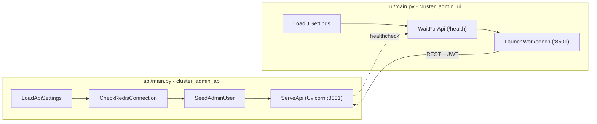

# 🎛️ NeuralForge Cluster Admin (`wyoloservice2_cluster_control`)


> Enterprise-grade centralized cluster administration, live telemetry dashboard, and dynamic hardware resource allocation platform (FastAPI + Modern Cloud SaaS SPA) engineered for the `train_service2` ecosystem.

---

## 🛠️ Key Technologies and Libraries

This microservice combines a high-performance RESTful API backend with an ultra-responsive, zero-latency Cloud SaaS single-page application:

*   **FastAPI (v0.110+):** Asynchronous Python framework providing RESTful API gateways, automatic OpenAPI/Swagger documentation (`/docs`), dependency injection, and high concurrency.
*   **Modern Cloud SaaS SPA (HTML5 + CSS3 + Vanilla JS):** High-performance single page application (< 80MB Docker image, < 10MB runtime RAM) featuring a modern dark glassmorphic design system (`Inter` & `JetBrains Mono`), top HUD ribbon with cluster health pulse, command search palette (`Ctrl+P` / `Ctrl+K`), horizontal navigation pill bar for instant access to all 11 operational views, collapsible bottom diagnostic and output logs drawer (`Ctrl+J`), and responsive telemetry widgets.
*   **Redis (v5.0+):** Low-latency in-memory data store for live physical heartbeats (`physical_*`), worker resource limits (`invoker:*:resources`), operator credentials (`cluster:auth:users`), scheduling policies, and dead-letter queues (`cluster:dlq:tasks`).
*   **Celery (v5.3+):** Asynchronous task and control protocol for real-time queue inspection (`active_queues`), worker signal delivery, scheduled delayed trial dispatch (`eta`), and cluster-wide Docker image broadcast synchronization (`force_docker_pull`).
*   **Optuna & Hyperparameter Sweeps:** Multi-trial sweep aggregation, metric convergence tracking, real-time learning curves, and batch cancellation.
*   **PyJWT & Cryptography:** Secure generation, digital signing, and validation of Bearer JWT access tokens with 24-hour expiration for administrative cluster operations.
*   **Pydantic (v2.6+):** Type validation, hardware model schemas, task definition payloads, and webhook serialization.
*   **Pytest & Pytest-Cov:** Comprehensive unit test suites and code coverage calculation strictly executed inside Docker containers.
*   **Uvicorn:** Production-ready ASGI server hosting the FastAPI backend.
*   **WPipe (v2.5.13):** Decoupled pipeline orchestration for microservice bootstrap (`main.py` + `dto/` + `states/`) with typed execution contexts.
*   **Docker & Docker Compose:** Modular multi-container stack (API on port `8001` and UI on port `8501`) isolated via internal bridge network with automated health checks.
*   **Kubernetes Pods & Dozzle:** Native orchestration support for ephemeral training Pods on RKE2/K3s with `spec.nodeName` pinning, `/dev/shm` shared memory sizing via `emptyDir`, `nvidia.com/gpu` resource limits, and real-time log streaming.

---

## 🗺️ System Architecture

```mermaid
flowchart TD
    subgraph UI_Layer [Frontend Layer - Modern Cloud SaaS SPA :8501]
        Login[🔐 Auth Overlay] --> Console[⚡ NeuralForge Cloud Console]
        Console --> Topbar[📑 Topbar: Cluster Health Pulse | Command Palette Ctrl+P | Quick Launch]
        Console --> NavPills[🧭 Navigation Pills: Operations | Nodes | Dispatch | Tasks | FinOps...]
        Console --> Viewports[📊 11 Dynamic High-Performance Viewports]
        Console --> TerminalDrawer[💻 Collapsible Bottom Diagnostic Drawer Ctrl+J]
    end

    subgraph API_Layer [API Gateway - FastAPI :8001]
        AuthRouter["/api/v1/auth/*"]
        InvokersRouter["/api/v1/invokers/*"]
        TasksRouter["/api/v1/tasks/*"]
        OverviewRouter["/api/v1/cluster/*"]
    end

    subgraph Data_Layer [Master Control Host 192.168.10.252]
        R[(Redis :23437)]
        CB[Celery Broker]
        Samba[(📂 Samba CIFS)]
        MinIO[(🪣 MinIO S3)]
    end

    subgraph Workers_Layer [Distributed Invoker Workers]
        Inv1[Invoker 192.168.1.68]
        Inv2[Invoker 192.168.1.72]
        InvN[Invoker N...]
    end

    Login -.->|POST /auth/login| AuthRouter
    Console -.->|REST 0ms latency| API_Layer
    InvokersRouter <-->|invoker:IP:resources| R
    InvokersRouter -.->|Celery control signals| CB
    OverviewRouter -.->|Celery active_queues probe| CB
    OverviewRouter -.->|Storage ping| Samba
    OverviewRouter -.->|Storage ping| MinIO
    TasksRouter <-->|study:*| R

    Inv1 <-->|Read & Apply MAX_GPU, RAM, CPU| R
    Inv2 <-->|Read & Apply MAX_GPU, RAM, CPU| R
    InvN <-->|Read & Apply MAX_GPU, RAM, CPU| R
```

---

## 🔐 Security & Initial Authentication

The platform enforces mandatory cryptographic authentication for API and web console access:

*   **Automatic Startup Seed:** On the first backend startup, if no administrator account exists in Redis, the system generates:
    *   **Username:** `wisrovi`
    *   **Password:** `wyoloservice`
*   **Cryptographic Persistence:** Operator credentials are saved with salted SHA-256 hashes (`salt$sha256`) in the Redis key `cluster:auth:users`.
*   **Bearer JWT Tokens:** Successful authentication generates a digitally signed JWT token valid for 24 hours.
*   **Password Management:** Operators can update their passwords directly from the **🛠️ Settings** console view.

---

## 📂 Project Structure (WPipe Architecture)

The API backend and UI frontend are separated into independent microservices, each with its own `Dockerfile`, `requirements.txt`, and WPipe lifecycle orchestrator (`main.py` + `dto/` + `states/`):

```text
wyoloservice2_cluster_control/
├── api/                         # 🔌 REST API service (FastAPI)
│   ├── Dockerfile
│   ├── requirements.txt
│   ├── main.py                  # WPipe pipeline entrypoint
│   ├── dto/api_startup_context.py
│   ├── states/                  # LoadApiSettings, CheckRedisConnection, SeedAdminUser, ServeApi
│   └── backend/                 # FastAPI app, routers, schemas, Redis/Celery client, auth
├── ui/                          # 🖥️ Static Cloud SaaS UI service
│   ├── Dockerfile
│   ├── requirements.txt
│   ├── main.py                  # WPipe pipeline entrypoint
│   ├── server.py                # Ultra-lightweight static HTTP server with dynamic config
│   ├── dto/ui_startup_context.py
│   ├── states/                  # LoadUiSettings, WaitForApi, LaunchWorkbench
│   └── static/                  # Modern Glassmorphic SPA (HTML5, CSS3, Vanilla JS views)
├── tests/api/  tests/ui/        # Dockerized pytest suites
├── docker-compose.yml           # API + UI stack with healthchecks
├── Makefile                     # build / up / down / logs / test / push
├── control_host.env.example     # Runtime configuration template
└── start.sh                     # Local development launcher
```

### WPipe Startup Pipelines



---

## 🚀 Deployment & Operations

### 1. Docker Compose (Recommended)

```bash
make setup     # Copies control_host.env.example to control_host.env
make up        # Builds and launches API + UI with automated health checks
make ps        # Inspects container statuses
make logs      # Streams live container logs
make down      # Stops the stack cleanly
```

| Service | Container | Docker Hub Image | Port |
| :--- | :--- | :--- | :--- |
| API | `neuralforge_cluster_admin_api` | `wisrovi/train_service:cluster_admin_api_v3.2.0` | `8001` |
| UI | `neuralforge_cluster_admin_ui` | `wisrovi/train_service:cluster_admin_ui_v3.2.0` | `8501` |

The UI waits until the API reports healthy (`depends_on: service_healthy`) and connects via the internal Docker network `cluster_admin_network` (`http://cluster_admin_api:8001`).

To build and publish images to Docker Hub:

```bash
make build && make push
```

### 2. Local Development (without Docker)

```bash
pip install -r api/requirements.txt -r ui/requirements.txt
make dev       # Starts both API and UI locally
```

Endpoints will be available at:
*   **Web Console UI:** [http://localhost:8501](http://localhost:8501)
*   **Backend API Documentation:** [http://localhost:8001/docs](http://localhost:8001/docs)

---

## 🧪 Unit Testing & Code Coverage

In strict compliance with ecosystem testing rules, all unit tests run inside an isolated Docker container (`python:3.10-slim`):

### Execute Unit Tests
```bash
make test      # Runs tests inside Docker container
```

### Calculate Code Coverage
```bash
make coverage  # Runs coverage analysis inside Docker container
```

---

## 📋 Primary REST API Endpoints

| Method | Endpoint | Description | Auth Required |
| :--- | :--- | :--- | :--- |
| `POST` | `/api/v1/auth/login` | Authenticates operator and returns JWT token | No |
| `GET` | `/api/v1/auth/me` | Returns current authenticated user | Yes |
| `POST` | `/api/v1/auth/change-password` | Updates password in Redis | Yes |
| `GET` | `/api/v1/cluster/overview` | Cluster summary, KPIs, and live node states | Yes |
| `GET` | `/api/v1/cluster/health` | Watchdog probing Redis latency, Celery, Samba, and MinIO | Yes |
| `GET` | `/api/v1/cluster/estimate-duration` | Dynamic duration, throughput (img/s), and ETA estimator | Yes |
| `GET` | `/api/v1/cluster/recommend-node` | AI-assisted optimal node recommendation | Yes |
| `GET` | `/api/v1/cluster/gpu-benchmarks` | Empirical throughput leaderboard across GPUs | Yes |
| `GET` | `/api/v1/cluster/green-ai` | FinOps carbon footprint and energy metrics | Yes |
| `GET` | `/api/v1/invokers` | Lists all invoker nodes with hardware allocations | Yes |
| `GET` | `/api/v1/invokers/{ip}` | Complete detail for a specific invoker node | Yes |
| `PUT` | `/api/v1/invokers/{ip}/limits` | Updates compute limits (`max_gpu_percent`, `max_ram`, `max_cpu_cores`, `shm_size_gb`) | Yes |
| `POST` | `/api/v1/invokers/{ip}/pause` | Pauses or resumes an invoker (supports temporal `until_time` and perpetual) | Yes |
| `POST` | `/api/v1/invokers/{ip}/drain` | Sets node into draining mode (finishes active tasks and pauses) | Yes |
| `GET` | `/api/v1/tasks/active` | Lists currently executing training tasks in real-time | Yes |
| `POST` | `/api/v1/tasks/quick-launch` | Dispatches training workloads with deferred execution (`start_not_before`) | Yes |
| `GET` | `/api/v1/tasks/history` | Historical trial logs with filtering and analytics | Yes |
| `POST` | `/api/v1/tasks/{id}/cancel` | Emits immediate cancellation signal to stop a running trial | Yes |
| `POST` | `/api/v1/cluster/images/broadcast-pull` | Triggers parallel Docker image pull broadcast to invokers | Yes |

---

## 👨‍💻 Author & License

*   **Author:** William Steve Rodriguez Villamizar (`wisrovi`)
*   **Email:** `wisrovi.rodriguez@gmail.com`
*   **License:** PolyForm Noncommercial License 1.0.0. See [LICENSE](LICENSE) and [COMMERCIAL.md](COMMERCIAL.md).

---

## 📝 Changelog

### v3.2.3 (2026-10-29)
*   **Celery Task Dispatch Routing:** Corrected `quick_launch_test` Celery task dispatch from unregistered `tasks.run_training` to `tasks.train_on_gpu_simple`.
*   **Ghost Active Workload Remediation:** Enhanced `get_study_details` to verify Celery task completion status (`SUCCESS`, `FAILURE`, `REVOKED`) and cancellation keys, automatically purging stale `study:{id}:active_trial` keys and preventing zombie tasks.
*   **Accurate Active Tasks Filtering:** Updated `list_active_tasks` to strictly filter out tasks whose computed status is not `"running"`.
*   **Kubernetes Pod Phase Reflection:** Replaced hardcoded "Running" pod phase with true execution state (`Running`, `Cancelled`, `Failed`, or `Succeeded`).

### v3.2.2 (2026-10-29)
*   **Decoupled Per-Invoker Pause Lifecycle & Removed Global Batch Buttons:**
    *   Removed global batch pause controls (`Pause 4h (All)`, `Pausa Hasta... (All)`, `Pause Indef. (All)`, and `Resume All`) from the UI toolbar and Command Palette.
    *   Enhanced individual node pause configuration modal with quick duration presets (`1h`, `2h`, `4h`, `8h`, `24h`), scheduled resumption shortcuts (`18:00`, `18:30`, `19:00`, `20:00`, `Mañana 08:00`), and perpetual pause mode.
    *   Added dedicated `▶️ Reanudar` and `✏️ Pausa` modification buttons in invoker table rows for granular per-node management.

### v3.2.1 (2026-10-29)
*   **Physical Hardware Capacity Guard & Smart Limits Modal:**
    *   Added physical hardware telemetry display to the compute limits modal showing real physical CPU cores, total host RAM, SWAP capacity, and GPU/VRAM for each node.
    *   Bounded slider limits strictly to physical capacity, added live remaining host resources reserved for the OS, and validated limits in backend with HTTP 400 rejection.

### v3.2.0 (2026-10-29)
*   **Modern Cloud SaaS Dashboard Redesign:**
    *   Migrated UI away from retro desktop styles to a high-end enterprise dark glassmorphic dashboard (Inter + JetBrains Mono).
    *   Modern SaaS topbar with live pulse indicator, compute fabric badges, and command search (`Ctrl+P` / `Ctrl+K`).
    *   Sleek horizontal navigation pill bar for instant access to all 11 views.
    *   Collapsible slide-up drawer for diagnostic and output logs (`Ctrl+J`).
*   **Deferred Training Workload Scheduling (`start_not_before` / ETA):**
    *   Added support for scheduling quick launch training workloads not to start before a given wall-clock time (`start_not_before: "HH:MM"`).
    *   Automatically calculates next Celery `eta` timestamp and dispatches to Celery delayed queue.
    *   Added visual deferred start checkbox and time picker in `dispatch.js`.
*   **Visual Controls for Fixed-Time Pause (`until_time`):**
    *   Added UI time selector and direct action button (`⏰ Pausar hasta hora`) in Streamlit nodes management view (`ui/frontend/views/invokers_view.py`) and API client (`ui/frontend/api_client.py`).
    *   Added fixed wall-clock time input to Workbench modal (`ui/static/js/views/nodes.js`) and API client (`ui/static/js/api.js`) allowing operators to pause an invoker until a scheduled time (e.g., `18:30`).
    *   Added batch schedule pause action (`⏰ Pausa Lote` / `⏰ Pausa Hasta...`) across all cluster nodes.
    *   Enhanced node cards with live scheduled resumption badges and direct `/dev/shm` indicators.

### v3.1.9 (2026-10-28)
*   **Scheduled Invoker Pause Wakeup & Process Schema Hardening:**
    *   Added support for pausing invokers until a specific wall-clock time (`until_time: "HH:MM"`), automatically computing target epoch timestamp for exact schedule resumption.
    *   Extended `InvokerPauseRequest` schema, `invokers_router.py`, and `redis_client.py`.
    *   Made `elapsed` field optional in `GpuProcessInfo` (`schemas.py`) to prevent response serialization failures during transient GPU process monitoring.
    *   Added unit test validation in `tests/api/test_api.py`.

---

<sub>Generated by WPipe MCP by wisrovi</sub>
